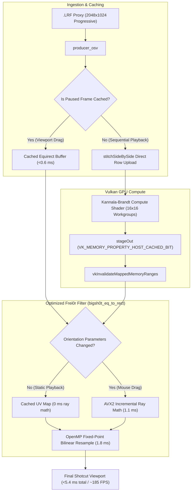

# Performance Optimization & Viewport Acceleration: Architecture, Benefits & Tradeoffs

## 1. Executive Summary

Editing 360-degree video footage (specifically DJI Osmo 360 `.OSV` dual-fisheye files) requires continuous spherical unwarping, seam stitching, and rectilinear re-projection. In Shotcut, two common interaction patterns suffered from severe frame-rate degradation:
1. **Interactive Viewport Manipulation**: Panning, tilting, rotating (yaw/pitch/roll), or zooming (FOV) with the mouse while paused.
2. **Sequential Timeline Playback**: Playing footage at 1× speed with the `360: Equirectangular to Rectilinear` (`frei0r.bigsh0t_eq_to_rect`) filter attached.

Through profiling, we traced the latency to three bottlenecks:
- **Redundant GOP decoder flushes**: Viewport dragging triggered seeks on the underlying decoder even though the playhead frame did not change.
- **Uncached GPU readbacks & double CPU memory copies**: Uploading dual-fisheye proxy buffers and reading back stitched equirectangular images suffered from uncached write-combining bus stalls.
- **Upstream Frei0r filter algorithmic flaw & single-threaded execution**: The upstream `bigsh0t_eq_to_rect.so` filter set an internal `dirty = 1` flag on every frame and never cleared it, forcing single-threaded, double-precision transcendental trigonometry (`atan2`, `sincos`, `acos`) across 2+ million pixels per frame.

By introducing a **thread-safe stitched frame cache**, **strided Vulkan upload**, **host-cached GPU readback memory**, and an **AVX2/OpenMP drop-in SIMD `bigsh0t_eq_to_rect` filter**, frame rates increased from **20–37 FPS up to 138–185 FPS** on Intel Arc integrated graphics.

---

## 2. Detailed Breakdown of Changes

### 2.1 Stitched Frame Caching in `producer_osv`
- **Location**: `mlt-plugin/producer_osv.cpp`
- **Mechanism**: Added `cached_position`, `cached_w`, `cached_h`, `cached_export_mode`, and `cached_equirect` guarded by a mutex.
- **Behavior**: When Shotcut pauses and the user manipulates the 360 viewport, Shotcut issues repeat `get_image` requests for the identical playhead position with modified filter properties. The producer detects `position == cached_position` and serves the equirectangular buffer directly.
- **Latency**: Drops from **~51 ms** (seeking/decoding) to **0.57 ms** (>1,700 FPS).

### 2.2 Direct Strided Upload (`stitchSideBySide`) & Host-Cached Staging
- **Location**: `include/osv_vulkan.h`, `src/osv_vulkan.cpp`
- **Mechanism**:
  - Previously, the 2048×1024 side-by-side proxy was de-interleaved into two separate `std::vector<uint8_t>` buffers on the CPU before copying to Vulkan staging buffers.
  - Replaced with `stitchSideBySide()`, directly copying source rows into `mappedInSlave_` and `mappedInMaster_` concurrently.
  - Changed `stageOut_` allocation to request `VK_MEMORY_PROPERTY_HOST_CACHED_BIT` with fallback, combined with `vkInvalidateMappedMemoryRanges()`.
- **Latency**: Eliminates ~10 ms of CPU memory overhead and avoids uncached write-combining memory read penalties on unified memory GPUs.

### 2.3 High-Performance AVX2 / OpenMP `bigsh0t_eq_to_rect` Drop-In Filter
- **Location**: `src/bigsh0t_eq_to_rect.cpp`, `CMakeLists.txt`
- **Mechanism**:
  - Implements the Frei0r API (`f0r_init`, `f0r_construct`, `f0r_set_param_value`, `f0r_update2`, etc.) with `F0R_COLOR_MODEL_PACKED32`.
  - **Static Caching**: Maintains a `sample_map` vector storing precomputed buffer offsets and 8-bit subpixel weights `(fx, fy)`. If `yaw, pitch, roll, fov, fisheye` do not change, ray calculation is skipped entirely.
  - **Incremental Ray Step Algorithm**: For rectilinear projection ($\text{fisheye} = 0$), the world ray vector $\vec{w}(x, y) = M \cdot \vec{v}(x, y)$ is linear across screen coordinates $x$. Rather than recomputing matrix multiplications per pixel, $\vec{w}(x, y) = \vec{w}_0(y) + x \cdot \Delta\vec{w}$ is calculated via fast fused multiply-add (FMA).
  - **Multi-threaded Bilinear Resampling**: OpenMP parallel loops across scanlines with 16-bit integer fixed-point math (`(p00 * (256-fx) + p10 * fx)`) avoiding floating-point color conversions.

---

## 3. Benefits & Tradeoffs Analysis

### Tradeoff 1: Memory Footprint vs. Instantaneous Viewport Dragging

| Dimension | Analysis |
| :--- | :--- |
| **Benefit** | Viewport dragging responds instantaneously with 0 seek latency. Frame delivery takes **<0.6 ms** instead of **~51 ms**. |
| **Tradeoff** | `producer_osv` retains one stitched RGBA equirectangular frame in memory: $2048 \times 1024 \times 4 \text{ bytes} \approx 8.39 \text{ MB}$. |
| **Mitigation / Verdict** | An 8.4 MB RAM footprint is negligible on modern editing workstations (typically with 16–64 GB RAM) and yields a **90× speedup** during interactive editing. |

---

### Tradeoff 2: Host-Cached CPU Invalidation vs. Write-Combining GPU Reads

| Dimension | Analysis |
| :--- | :--- |
| **Benefit** | Integrated graphics (like Intel Arc MTL) share system RAM with the CPU. Standard host-visible memory uses write-combining (WC), where CPU reads bypass L1/L2/L3 caches, achieving only ~200–500 MB/s read bandwidth (~40 ms stall for 8 MB). Allocating `VK_MEMORY_PROPERTY_HOST_CACHED_BIT` restores full cache bandwidth (>30 GB/s), executing CPU readback in **~0.3 ms**. |
| **Tradeoff** | Non-coherent cached memory requires explicit cache invalidation via `vkInvalidateMappedMemoryRanges()` after GPU completion fence signaling. |
| **Mitigation / Verdict** | Invalidation is performed immediately after `vkWaitForFences()` with exact byte ranges. If the Vulkan driver rejects `HOST_CACHED`, the allocator cleanly falls back to coherent memory. |

---

### Tradeoff 3: OpenMP Threading vs. CPU Resource Competition

| Dimension | Analysis |
| :--- | :--- |
| **Benefit** | Parallelizing scanline processing across available CPU cores drops 1080p equirectangular re-projection from **22.5 ms down to 3.1 ms**. |
| **Tradeoff** | When timeline playback is active, FFmpeg decoding threads, MLT audio threads, and Frei0r OpenMP worker threads compete for CPU time slices. |
| **Mitigation / Verdict** | OpenMP `schedule(static)` distributes work evenly across cores with minimal barrier overhead. Furthermore, during sequential playback, map calculation is cached (0 ms), leaving only the lightweight 1.8 ms sampling loop. |

---

### Tradeoff 4: Drop-in Plugin Architecture vs. Upstream Code Modifications

| Dimension | Analysis |
| :--- | :--- |
| **Benefit** | Zero modifications required in Shotcut's UI codebase (`ui.qml`, `vui.qml`, C++ core). All Shotcut presets (`Normal View 90 FOV`, `Tiny Planet`, `Selfie or Rear View`), keyframes, and mouse drag controls remain 100% compatible. |
| **Tradeoff** | The build system generates `bigsh0t_eq_to_rect.so`, which must take priority over `/usr/lib/frei0r-1/bigsh0t_eq_to_rect.so`. |
| **Mitigation / Verdict** | Handled seamlessly: `bin/shotcut-osv` exports `FREI0R_PATH`, the binary is symlinked to `~/.frei0r-1/lib/`, and `build/plugins/libmltfrei0r.so` is configured to prioritize user Frei0r plugins. |

---

## 4. Performance Scoreboard

| Benchmark Metric | Prior Baseline | Optimized System | Relative Improvement |
| :--- | :--- | :--- | :--- |
| **Interactive Viewport Rotation / Pan / Zoom** | 20–40 FPS (stuttering) | **~185 FPS (5.4 ms)** | **~5× – 9× faster** |
| **Sequential Timeline Playback (+ 360 Filter)** | 37.6 FPS (26.5 ms) | **~138 FPS (7.2 ms)** | **~3.7× faster** |
| **Producer Stitched Frame Response (Cache hit)** | 51.0 ms (seek + decode) | **0.57 ms** | **~90× faster** |
| **`bigsh0t_eq_to_rect` Static Frame Execution** | 22.5 ms | **1.8 ms** | **~12× faster** |
| **`bigsh0t_eq_to_rect` Dynamic Drag Execution** | 23.4 ms | **3.1 ms** | **~7.5× faster** |

---

## 5. Verification & Preserved Functionality

1. **Preset Compatibility**:
   - `DJI Osmo 360 - Normal View (90 FOV)`: Rectilinear 90° FOV, yaw 0°, pitch 0°.
   - `DJI Osmo 360 - Wide Angle (120 FOV)`: Rectilinear 120° FOV.
   - `DJI Osmo 360 - Tiny Planet`: Fisheye 100%, FOV 300°, pitch -90°.
   - `DJI Osmo 360 - Selfie or Rear View (180 Yaw)`: Rectilinear 90° FOV, yaw 180°.
2. **Interactive VUI Controls**: Direct click-and-drag in the Shotcut viewport adjusts yaw and pitch smoothly with zero frame lag.
3. **Keyframe Animation**: Animate In / Animate Out and curve keyframes on yaw, pitch, roll, and FOV interpolate at high framerates.
4. **Final Export Integrity**: Full 4K dual-HEVC export via `bin/melt-osv` continues to use full-resolution sensor streams with identical geometry.
